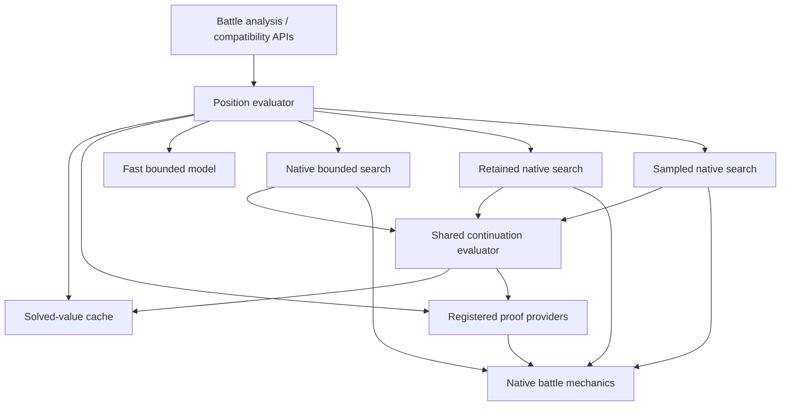

# Shared position evaluation

## Ownership

Temporal probe/scoring boundaries and lookup-cache ownership are documented in
[Feature evaluation and caches](FEATURE-EVALUATION-DESIGN.md).

`position-evaluator.mjs:evaluatePosition` is the single public orchestration entry. `analyzeBattle`, `simulateCompleteMoves` and the sampled-search compatibility facade delegate to it. It selects eligible proofs, looks up solved values, and chooses the fallback engine. Engine implementations do not import proof providers.

- **Native mechanics:** `native-battle.mjs` creates/restores battles, applies live state, enumerates chance and exposes legal moves. It does not import search orchestration.
- **Native input and bounded search:** `native-search.mjs` validates/prepares native inputs once and runs the bounded native adapter. Its continuation resolver comes from the evaluator.
- **Approximate strategies:** `sampled-search.mjs` and `retained-turn.mjs` implement their strategies and use the supplied evaluation context for continuation proofs. They have no knowledge of the fixed-retaliation solver. A solved child updates retained bounds without being counted as a Monte Carlo rollout.
- **Proof providers:** `exact-endgame.mjs` and `passive-endgame.mjs` register bounded mathematical domains. The fixed-retaliation provider declares a cheap snapshot applicability filter and a guarded native solver. It does not prepare snapshots, own session caches, choose search engines or format forecasts. Adding another proof provider requires registering it in the evaluator, not editing search loops.
- **Result contract:** the evaluator formats proof results with coincident bounds and provenance under `proof`. Existing `result-contract.mjs` continues to classify all final engine outputs. Approximate continuation use never converts the surrounding sampled calculation into a certificate.
- **Compatibility:** `complete-moves.mjs` and `sampled-moves.mjs` retain their public export names as small facades. Internal mechanics consumers import the mechanics module directly, so mechanics no longer depend on forecast initialization. The old `exactEndgameChecked` flag and the separate snapshot/native proof-result helpers are removed.

## Evaluation flow

1. When a native-capable caller supplies a snapshot, determine whether a proof or native route needs native preparation. Unrelated legacy positions avoid that cost.
2. Validate and prepare the native position once when needed. Missing input prevents proof publication.
3. Look up a solved value using solver version, complete native state key, opponent model and NPC options. The bounded cache lives in `session.positionValues` and survives worker context updates.
4. Try enabled proofs at most once per native state during this evaluation. A failed or timed-out attempt is not permanently cached; a later pass may retry. Warm-only requests only look up existing proofs. Cancellation and deadlines prevent proof work and publication.
5. On a proof miss, dispatch to the selected engine. Native search continuations reuse the same context, cache and proof-attempt set. Continuation probes do not recursively start another full search.

The fast bounded model retains its own compact state representation and internal search cache. Native continuation proofs require lossless native state; the evaluator does not invent missing native history to apply them to compact states. Its root still passes through the common proof and dispatch stage.

Resumable proof providers expose `start`/`advance`; the evaluator owns a 32-entry `positionProofWork` map alongside solved values. Pending native compilation and resource-graph frames survive slices and matching worker context changes. Successful work moves into the solved-value cache. Unsupported or incomplete work never changes result certainty. See [the bounded passive solver design](PASSIVE-ENDGAME-SOLVER.md).

## Regression coverage

New evaluator contract tests verify shared snapshot/native/continuation caches; opponent-model isolation; one failed proof attempt per evaluation with later retry; legacy fallback exactly once; no proof work on missing data, cancellation or an uncached warm-only request; invalidation on changed native input; and shared continuation use in both bounded and sampled native search. Dependency-boundary tests keep mechanics and strategy implementations independent of proof providers.

The existing exact-target, live-first-result, status/item/counter rejection, worker lifecycle and battle progression tests remain in place. Proof equations and battle-mechanics guards are unchanged by this reorganization. The legacy diagnostic `exact_endgame` field is replaced by generic `proof` provenance; scores, bounds and display contracts remain unchanged.

## Validation after consolidation

All 421 tests passed. The six proved-complex cases were rerun under minimax and NPC scoring: the same three eligible cases return exact targets with zero rollouts, while status/item cases retain sampled fallback behavior. Eligible warm first estimates were 18-30 ms across these exploratory single-trial runs. Three preloaded live-worker trials published the correct 81% as the first result in 151-185 ms. Initialization is excluded from that decision timer and recorded separately.

Reports: `analysis/benchmarks/shared-evaluator-minimax-2026-10-18.json`, `shared-evaluator-npc-2026-10-18.json`, and `shared-evaluator-worker-2026-10-18.json`. These measurements check for a material regression on this suite, not statistical equivalence or universal latency.

## Temporal estimates and refinement

`position-features.mjs` owns approximate native position features used by both
continuation policy probes and unfinished rollout leaves. It restores isolated
native battles to measure legal move damage before HP clipping, healing capacity,
remaining healing/protection PP, future Struggle costs, and passive HP timelines.
Native residual callbacks account for items, abilities, Toxic stages and timers. A repeated tick after native consumption separates renewable healing from a finite burst. Action healing records native move/drain heal events, so a berry triggered during a probe is not multiplied by move PP.
The feature cache uses the observed mechanics key and is bounded; the original
battle, RNG and request are never modified. Deadlines interrupt unfinished work. Action cursors and partial passive snapshots resume across slices; completed action PP is counted once. Partial caches store serialized state rather than native battle objects.

The score compares logarithms of estimated survival turns, so relative endurance matters across different HP scales. Nonterminal values stay between 0.02 and 0.98.

The endurance comparison is a heuristic: it combines finite resources and passive
clocks rather than proving a legal schedule against every opponent response.
A 32-tick passive projection and two action probes are bounded approximations.
They cannot certify arbitrary recovery loops, setup, delayed heals or disruption.
Proofs continue to belong to the evaluator's registered providers.

Continuation policies weight a stratified binary probe by native probabilities.
Single-row or single-column games choose optimal pure actions (or genuine ties)
without fictitious-play pseudocounts leaking into inferior actions. General
simultaneous games retain mixed strategies. Policy version 3 invalidates old
continuation/root estimates.

Rollout observations have depth-specific estimator epochs. Work counters remain
cumulative, but a covered deeper epoch replaces the earlier displayed estimator
instead of averaging incompatible short and long forecasts forever. Promotion
requires four observations and coverage of every first-turn chance stratum when
an earlier estimate exists. Confidence uses the newest epoch immediately, so old
samples cannot justify pruning its unresolved depth. Retained child priors use
the same epochs; a shorter child estimate cannot overwrite a deeper root value.
Children may refine up to the configured sample target rather than stopping at
eight samples before reaching a long horizon. Each pass retains its time budget.

For a forced continuation whose next native turn has only terminal outcomes,
`exactEnding` integrates its chance branches (at most 48 enumeration steps).
This conditional expectation reduces rollout variance, including rare final
Protect outcomes. It does not certify the policy leading to that turn, and a
failed or interrupted enumeration falls back to ordinary sampling. This remains
a sampling optimization, separate from registered optimal-position proofs.
